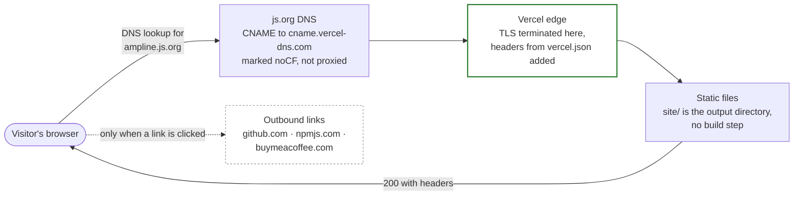
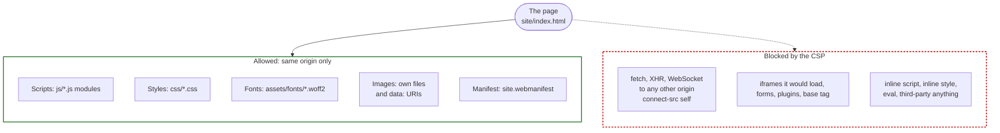

# Deployment and security

How a visitor's request reaches the static files, and what the response headers let the page do
once it is in the browser. The site is live at <https://ampline.js.org> on Vercel. The js.org
entry and the Vercel project are set up by Carter outside this repo; the only server-side
configuration the repo controls is [`../vercel.json`](../vercel.json). The policy summary is in
[`../SECURITY.md`](../SECURITY.md).

## Request path

**Why `noCF`.** js.org normally proxies records through Cloudflare. Vercel needs to answer the
request itself so it can issue the certificate and serve the headers, so the record is marked
`// noCF` and stays DNS-only. See D2 in [`../DECISIONS.md`](../DECISIONS.md). The js.org entry
lives in a third-party repo, so changes to it are Carter's to make.

**Where each control lives.** DNS and the CNAME are js.org's. TLS and the edge are Vercel's.
The headers, the clean URLs (`/og-card` serves `og-card.html`, no trailing slash) and the cache
rules are in `vercel.json`, which `npm run dev` (`scripts/serve.mjs`) also applies locally so a
CSP violation shows up before deploy. `vercel.json` sets `Strict-Transport-Security` explicitly
(`max-age=31536000`, no `includeSubDomains`, no `preload`; see D20, which also says why), and `upgrade-insecure-requests`
in the CSP upgrades any stray `http:` subresource. Browsers ignore HSTS over plain `http://`, so the
dev server sending it on `127.0.0.1` is harmless.

**Ordering.** The Vercel project already claims `ampline.js.org`. Keep it that way: a CNAME
pointing at Vercel that no project claims can be taken over by another Vercel account. If the
project is ever deleted or the domain removed from it, remove the js.org record first. Keep Vercel Web Analytics and Speed Insights off: they would add third-party requests, and
the Vercel preview toolbar loads from `vercel.live`, so `*.vercel.app` previews show CSP errors
for signed-in team members. Production visitors are not affected.

## What the headers allow

Because the CSP forbids inline styles, the site has no `style=` attributes in HTML. The one
place a color or weight is applied is `renderAnsi()`, which sets it through the CSSOM
(`element.style.color`), and CSSOM writes are not blocked by `style-src 'self'`. Because it
forbids `eval`, the vendored renderer is pre-wrapped as functions instead of being evaluated.

## Response headers (`vercel.json`)

Sent on every path (`/(.*)`):

| Header | Value | Effect |
| --- | --- | --- |
| `Content-Security-Policy` | see the directive table below | Same-origin loads only |
| `X-Content-Type-Options` | `nosniff` | The browser trusts declared content types |
| `Referrer-Policy` | `strict-origin-when-cross-origin` | Cross-origin requests carry the origin only, never a path (the outbound links add `noreferrer`, so they send none at all) |
| `Permissions-Policy` | `camera=(), microphone=(), geolocation=(), interest-cohort=()` | Those features and FLoC are off |
| `Cross-Origin-Opener-Policy` | `same-origin` | No shared browsing context with pages opened from here |
| `Strict-Transport-Security` | `max-age=31536000` | HTTPS only for a year on this host. No `includeSubDomains` (ampline.js.org has no subdomains to cover) and no `preload` (a hard-to-undo browser-list commitment on a name under js.org, which we do not own) |

**Added by the platform, not by `vercel.json`.** Vercel adds `Access-Control-Allow-Origin: *` to
the static responses on its own (seen on the live `/`). It is harmless for a public site that
sets no cookies and takes no credentials: any page may read these files, which are public anyway.
It is a platform default, not a policy of this repo, and it does not affect who may frame the page
(that is `frame-ancestors`, below) or what the page may load. The dev server does not send it.

Cache rules (separate entries, only `Cache-Control`): `/assets/*` is `public, max-age=31536000,
immutable` (filenames carry a version, such as `wordmark.v1.svg` or `mono-400.v2.woff2`; a changed asset gets a new name), and `og.png`, `favicon.ico`,
`icon.svg` and `apple-touch-icon.png` are `public, max-age=86400`.

## CSP directives

| Directive | Value | Why |
| --- | --- | --- |
| `default-src` | `'none'` | Anything not listed below is denied |
| `script-src` | `'self'` | Own modules only. No inline script (the JSON-LD block is data, not executed), no `eval` |
| `style-src` | `'self'` | Own stylesheets only. No inline styles |
| `img-src` | `'self' data:` | Own images, plus `data:` URIs |
| `font-src` | `'self'` | Self-hosted fonts only |
| `connect-src` | `'self'` | Script can reach only the site's own origin (Lighthouse's `robots.txt` check needs this). No site code opens a connection at all |
| `manifest-src` | `'self'` | Own web manifest |
| `base-uri` | `'none'` | No `<base>` rewriting |
| `form-action` | `'none'` | The page has no forms |
| `frame-ancestors` | `https://cartertull.com https://www.cartertull.com` | Only the portfolio (apex and www) can embed the site in a frame; every other origin is refused (D23). Unlike the directives above it names remote hosts, because it controls who may frame this page, not what the page loads |
| `object-src` | `'none'` | No plugins |
| `upgrade-insecure-requests` | (flag) | Any `http:` subresource is upgraded to `https:` |

## Zero third-party origins

The page loads nothing from any other origin: no CDN, no analytics, no web-font host, no
widget. The Buy Me a Beer control is a plain `<a>` with `target="_blank"` and
`rel="noopener noreferrer"`, with no script. These are held by tests rather than by habit:
`html-contract.test.mjs` fails on any third-party script, stylesheet, font or image tag, any
`style=` or `on*=` attribute, any `innerHTML` write in `site/js/`, and any remote `url()` or
`@import` in the CSS. It also fails on any `fetch(`, `XMLHttpRequest`, `WebSocket`, `sendBeacon`
or `EventSource` in `site/js/`, so the same-origin `connect-src` cannot hide a regression, and it pins
the header value. The outbound links are navigations the visitor chooses, not requests the
page makes.

---
_Last verified: 2026-10-28 · site 1.0.0_
