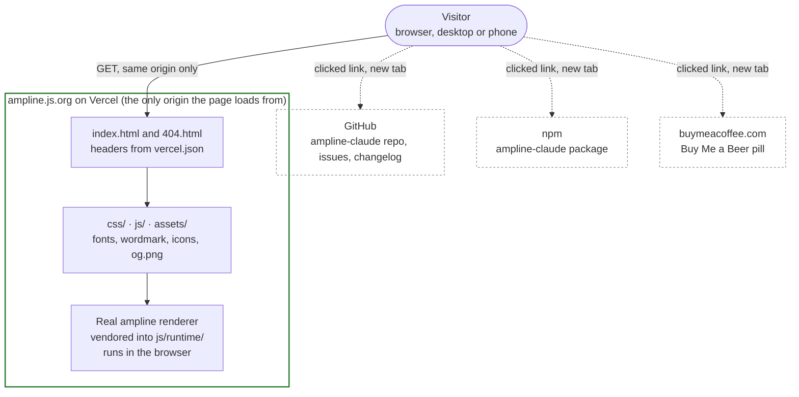

# Overview: the whole system in one diagram

Start here. The ampline website is a plain static site: HTML, CSS and native ES modules in
`site/`, served by Vercel with no build step. There is no server code, no database, no API and
no analytics. The visitor's browser downloads the files from one origin and runs everything
locally, including the real ampline renderer that draws the demo statuslines. Every box below
is expanded in its own diagram (see the table at the bottom).

**The one thing to take away:** the page makes no requests of its own to anyone but its own
origin. The three dashed boxes are only reached when a visitor clicks a plain `<a>` link that
opens in a new tab with `rel="noopener noreferrer"`. The page never fetches from them, which
the CSP enforces (`connect-src 'none'`). See [`deployment-security.md`](deployment-security.md).

**The demos are the real renderer, not screenshots or typed strings.** `scripts/sync-ampline.mjs`
copies ampline-claude's source into `site/js/runtime/factories.generated.js` at development
time, and a small in-browser `require` registry runs it. See
[`render-pipeline.md`](render-pipeline.md) for how, and [`release-sync.md`](release-sync.md)
for how it gets updated.

**Phase 1 ships a static playground preview.** The interactive playground and the installer
demo are planned for Phase 2 and are not drawn here as built. See
[`page-structure.md`](page-structure.md).

## Go deeper

| Question | Diagram |
| --- | --- |
| How does the real ampline renderer run in the browser, and how is it tested? | [`render-pipeline.md`](render-pipeline.md) |
| What are the sections of the page, and which module fills each one? | [`page-structure.md`](page-structure.md) |
| How does a request reach the files, and what do the headers and CSP allow? | [`deployment-security.md`](deployment-security.md) |
| What happens when ampline-claude publishes a new version? | [`release-sync.md`](release-sync.md) |
| How do I keep these diagrams current? | [`README.md`](README.md) |

---
_Last verified: 2026-10-09 · site 0.1.0_
