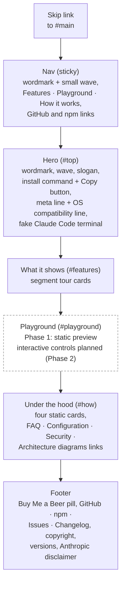
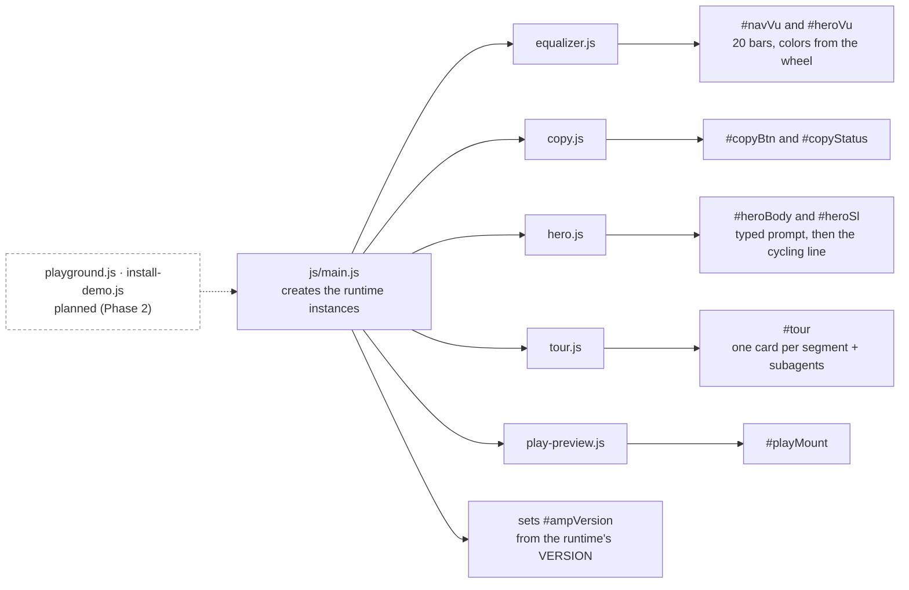

# Page structure

`site/index.html` is one scrolling page. Most of it is static markup. The parts that show
statuslines or move are empty containers that `site/js/main.js` fills after the document is
parsed. `404.html` is a small second page with the same nav and footer.

## Sections in order

The Playground section is the only one that is a placeholder. Its lead says the controls are
coming soon, and what it shows today is one real rendered statusline in a terminal frame. The
installer demo is also planned for Phase 2 and has no section yet.

## Which module fills which container

**What is not filled by JavaScript.** The nav, hero text, section headings and leads, the four
"Under the hood" cards, and the whole footer are plain HTML. With JavaScript off, the page
still reads, but the wave bars, the demo statuslines and the tour are empty. The static
`#ampVersion` text is the fallback that `main.js` overwrites.

**The hero wave is independent of the hero line.** Both waves (nav and hero) are mounted once by
`main.js` and animate freely. The cycling line does not hold or highlight a bar for the current
model, so the wave never breaks its rhythm. Only the OG card's still image marks one bar. See D18
in [`DECISIONS.md`](../DECISIONS.md).

**Each statusline container has its own runtime instance** where it matters. The hero line
cycles through models and efforts on a timer (paused while the tab is hidden and off under
`prefers-reduced-motion`). The tour gets a wide instance that it reconfigures per card. The
playground preview gets one of its own. See [`render-pipeline.md`](render-pipeline.md).

**Two pages outside the flow.** `og-card.html` is a render target: its `og-card.js` builds the
social card from the same runtime, and `site/og.png` is a screenshot of it at 1200x630. It is
marked `noindex` and disallowed in `robots.txt`.

---
_Last verified: 2026-10-12 · site 0.2.0_
