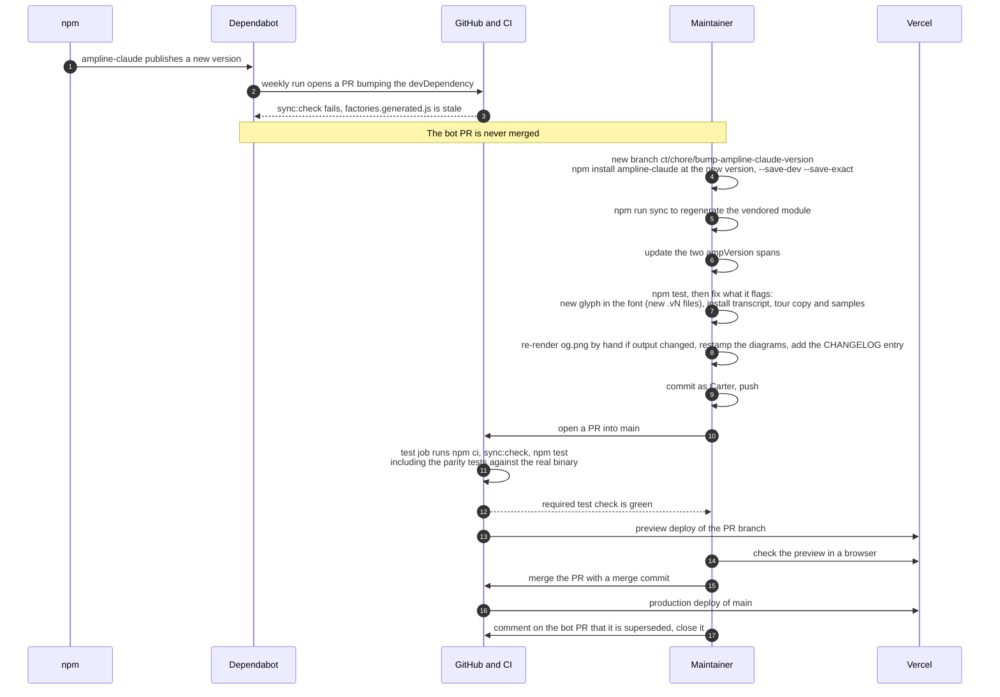

# Release sync: following a new ampline-claude version

The site vendors a specific ampline-claude release, so every release of the package needs a
matching update here. Dependabot notices the new version and opens a PR, but that PR is never
merged: merging a bot PR would add the bot as a contributor. Instead the same bump is re-applied
on a branch of Carter's, which is what gets merged. The site is live on Vercel at
<https://ampline.js.org>: PRs get preview deploys and `main` deploys to production. The Vercel
project settings and deploys are Carter's to run.

## Bump to production

## What each gate catches

| Gate | Where | Fails when |
| --- | --- | --- |
| `npm run sync:check` | CI `test` job, and `sync.test.mjs` | the committed `factories.generated.js` differs from what `scripts/sync-ampline.mjs` writes from the installed package |
| `sync.test.mjs` | `npm test` | a vendored file is not embedded verbatim, `VERSION` does not match the installed package, or a vendored file requires a module that is neither vendored nor stubbed (a new lib module in a release) |
| `runtime-parity.test.mjs` | `npm test` | the browser runtime's output differs from the real ampline-claude binary for any demo payload (a new release changed rendering in a way the shims or payloads no longer match) |
| `fakes.test.mjs` | `npm test` | the git or task fakes no longer print what the real binary prints for a real throwaway git repo and todo file (the git cases are skipped when git is missing) |
| `font-coverage.test.mjs` | `npm test` | the renderer or the site draws a glyph that the self-hosted mono woff2 files do not map (a new glyph in a release), or a file under `site/assets/` is referenced but missing or has no `.vN.` version in its name |
| `install-transcript.test.mjs` | `npm test` | the pinned installer's stdout differs from `INSTALL_TRANSCRIPT` in `install-demo.js` (the machine-dependent Node line and re-run note are masked) |
| `html-contract.test.mjs` | `npm test` | the static `#ampVersion` text in `index.html` or `404.html` does not equal the pinned devDependency |
| `tour.test.mjs` | `npm test` | a tour card's sample no longer matches what the real renderer prints for that segment |

**What nothing checks.** `site/og.png` is a 1200x630 screenshot of `site/og-card.html`, rendered
by hand in Chrome. Tests only verify its size and format, so if a release changes the
statusline's output the card has to be re-rendered by hand. The two `#ampVersion` spans are also
edited by hand (the tests enforce them, but do not write them). Font glyph coverage is checked
(`font-coverage.test.mjs` fails on a missing glyph), but rebuilding the font subset and renaming it
to the next `.vN` is a manual recipe (`scripts/fonts/README.md`). The prose of the tour cards, the
playground notes and the other site copy is not checked against the release notes, and the diagram
stamps and the CHANGELOG entry are written by hand. None of these steps is automated.

**Why the bump is re-applied rather than merged.** Carter is the only author and contributor on
this repo (D13 in [`../DECISIONS.md`](../DECISIONS.md)). The bot PR is closed with a link to
Carter's own PR. The Dependabot config also watches `github-actions`, and those PRs follow the
same rule.

---
_Last verified: 2026-10-28 · site 1.0.0_
