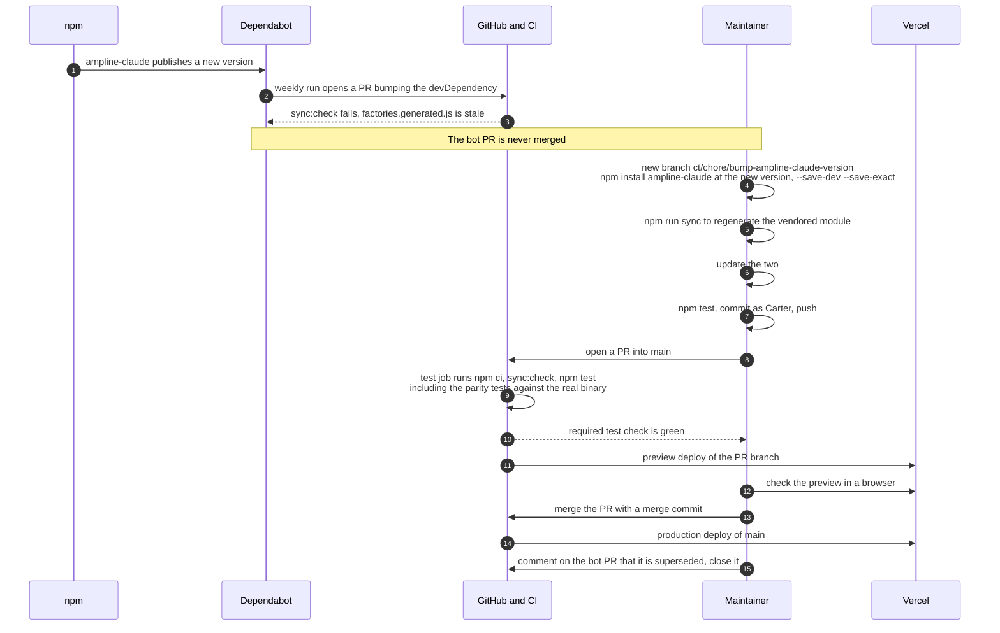

# Release sync: following a new ampline-claude version

The site vendors a specific ampline-claude release, so every release of the package needs a
matching update here. Dependabot notices the new version and opens a PR, but that PR is never
merged: merging a bot PR would add the bot as a contributor. Instead the same bump is re-applied
on a branch of Carter's, which is what gets merged. Vercel deploys are Carter's to run.

## Bump to production

## What each gate catches

| Gate | Where | Fails when |
| --- | --- | --- |
| `npm run sync:check` | CI `test` job, and `sync.test.mjs` | the committed `factories.generated.js` differs from what `scripts/sync-ampline.mjs` writes from the installed package |
| `sync.test.mjs` | `npm test` | a vendored file is not embedded verbatim, or `VERSION` does not match the installed package |
| `runtime-parity.test.mjs` | `npm test` | the browser runtime's output differs from the real ampline-claude binary for any demo payload (a new release changed rendering in a way the shims or payloads no longer match) |
| `fakes.test.mjs` | `npm test` | the git or task fakes no longer match the captured real bytes |
| `html-contract.test.mjs` | `npm test` | the static `#ampVersion` text in `index.html` or `404.html` does not equal the pinned devDependency |
| `tour.test.mjs` | `npm test` | a tour card's sample no longer matches what the real renderer prints for that segment |

**What nothing checks.** `site/og.png` is a 1200x630 screenshot of `site/og-card.html`, rendered
by hand in Chrome. Tests only verify its size and format, so if a release changes the
statusline's output the card has to be re-rendered by hand. The two `#ampVersion` spans are also
edited by hand (the tests enforce them, but do not write them). Neither step is automated.

**Why the bump is re-applied rather than merged.** Carter is the only author and contributor on
this repo (D13 in [`../DECISIONS.md`](../DECISIONS.md)). The bot PR is closed with a link to
Carter's own PR. The Dependabot config also watches `github-actions`, and those PRs follow the
same rule.

---
_Last verified: 2026-10-09 · site 0.1.0_
