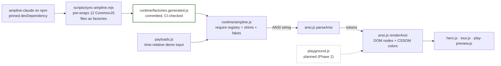
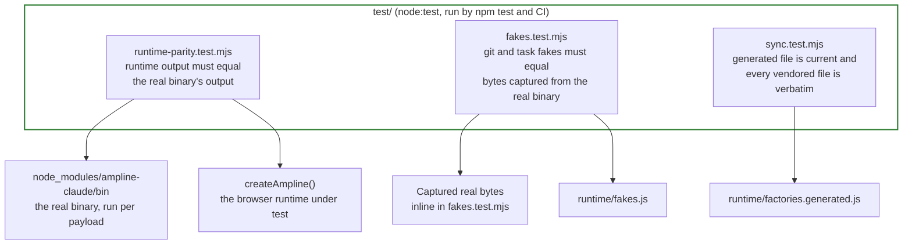

# Render pipeline: from the npm package to pixels

Every statusline on the page is output of ampline-claude's own renderer, never a hand-typed
string. The renderer is CommonJS written for Node, and the site's CSP forbids `eval`, so the
sync script pre-wraps each file as a factory function at development time. A small `require`
registry in the browser runs those factories with stubs for the Node-only parts. The renderer's
output is an ANSI string, which is parsed into tokens and turned into DOM nodes (never HTML
strings).

## Source to screen

**What `sync-ampline.mjs` copies.** Twelve files from `ampline-claude/lib`, byte for byte: `colors`,
`bar`, `layout`, `usage`, `config`, `render` and the segments `model`, `context`, `rateLimits`,
`cost`, `pr`, `subagents`. It deliberately does not copy `git`, `task`, `cache`, `claudeDir` or
`install`, because they need `fs` or `child_process`. `npm run sync:check` (run in CI) fails when
the committed file differs from what the script would write now. Nothing hand-edits the
generated file.

**What the runtime replaces.** `createAmpline()` in `runtime/ampline.js` gives each instance its
own registry. These requests do not reach the vendored code as written:

| Request | What the browser gets |
| --- | --- |
| `cache` | an in-memory `Map` with the same `read` / `write` / `remove` shape |
| `config` `loadConfig()` | the instance's current config (`setConfig()`), validated by the real `validateAndMerge` |
| `segments/git`, `segments/task` | fakes from `runtime/fakes.js` that read the payload's demo-only `__demo` field |
| `fs`, `crypto`, `child_process` | stubs that throw if anything calls them |
| `path`, `os`, `claudeDir` | small shims (`/home/you`, with `.claude` under it) |

**The page uses several instances on purpose.** `main.js` makes a 120-column instance for the
hero, a separate 500-column one for the tour (which reconfigures segments per card) and another
120-column one for the playground preview, so config set for one never leaks into another.
`NO_COLOR` is read once when `colors.js` loads, which is why color and no-color are separate
instances.

## How it is kept honest

**Parity.** For each demo payload, `runtime-parity.test.mjs` spawns the real ampline-claude
binary from `node_modules` with the payload on stdin, renders the same payload through
`createAmpline()`, and asserts the two strings are identical. The demo-only `__demo` field is
stripped first, because the real binary has no repo or todo file to read in that sandbox.

**Fakes are pinned separately.** Because parity cannot cover the git and task segments, the
output format of the two fakes is pinned to bytes captured from the real binary in
`fakes.test.mjs`. If ampline-claude changes how those segments render, the test fails and the
fakes get updated by hand.

**The last step has its own tests.** `ansi.test.mjs` covers `parseAnsi` and `renderAnsi`,
`payloads.test.mjs` covers the wheel index and the demo payload builders, and `tour.test.mjs`
checks each tour card against the renderer's real single-segment output. The page-level contract (CSP-safe HTML, no third-party resources) is
`html-contract.test.mjs`.

---
_Last verified: 2026-10-09 · site 0.1.0_
